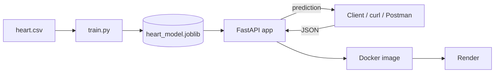

<h1 align="center">Heart Disease Prediction API</h1>

<p align="center">
  A machine learning REST API that predicts the presence of heart disease from 13 clinical measurements,
  built with FastAPI, containerized with Docker and deployed on Render.
</p>

<p align="center">
  
  
  
  
  
</p>

<p align="center">
  <b>Live demo:</b> <a href="https://heart-disease-prediction-ic6l.onrender.com">heart-disease-prediction-ic6l.onrender.com</a> &nbsp;|&nbsp;
  <b>Swagger docs:</b> <a href="https://heart-disease-prediction-ic6l.onrender.com/docs">/docs</a>
</p>

<p align="center">
  <sub>Hosted on Render's free tier, so the first request after a period of inactivity can take up to a minute while the service wakes up.</sub>
</p>

---

## Overview

Heart disease is one of the leading causes of death worldwide, and early screening can make a real difference. This project trains a classifier on the [Kaggle Heart Disease dataset](https://www.kaggle.com/datasets/johnsmith88/heart-disease-dataset) and serves it through a simple API. You send a patient's clinical values as JSON and get back a prediction and a probability.

The main focus of the project is the deployment side: a clean API with input validation, a reproducible Docker image, and a one-click deploy on Render.

**Highlights**

- Logistic regression pipeline (feature scaling + classifier) with **~81% test accuracy**
- Request validation with Pydantic, so out-of-range or missing values return a clear `422` error
- Interactive Swagger UI generated automatically by FastAPI
- Dockerized, so it can be started with a single `docker-compose up`
- Deployed as a Docker web service on Render

## How it works



1. `train.py` trains a `StandardScaler` + `LogisticRegression` pipeline and saves it with joblib.
2. The FastAPI app loads the saved model once at startup.
3. `/predict` validates the input, runs the model and returns the result.
4. The Dockerfile packages the app and model, and Render builds and runs that image.

## Tech stack

| Layer | Tools |
| --- | --- |
| Model | scikit-learn, pandas, NumPy, joblib |
| API | FastAPI, Pydantic, Uvicorn |
| Packaging | Docker, Docker Compose |
| Hosting | Render |

## Project structure

```
.
├── app/
│   ├── __init__.py
│   ├── main.py             # FastAPI app and endpoints
│   └── schemas.py          # request / response models
├── data/
│   └── heart.csv           # dataset (1025 rows)
├── model/
│   └── heart_model.joblib  # trained pipeline
├── train.py                # training script
├── requirements.txt
├── Dockerfile
├── docker-compose.yml
└── README.md
```

## Model performance

Trained on an 80/20 stratified split (`random_state=42`).

| Metric | No disease (0) | Disease (1) |
| --- | --- | --- |
| Precision | 0.89 | 0.76 |
| Recall | 0.70 | 0.91 |
| F1-score | 0.78 | 0.83 |

**Overall test accuracy: 0.81**

The model leans towards high recall for the disease class, so it misses fewer actual cases. For a screening tool, that is the better trade-off.

## Getting started

### Run with Docker (recommended)

```bash
git clone https://github.com/SrejonFerdous/Heart-Disease-Prediction.git
cd Heart-Disease-Prediction

docker-compose build
docker-compose up
```

Then open **http://localhost:8000/docs** to try the API in the browser.

### Run without Docker

```bash
pip install -r requirements.txt
uvicorn app.main:app --reload
```

### Retrain the model (optional)

The trained model is already included, but you can retrain it with:

```bash
python train.py
```

## API reference

The examples below use `localhost:8000`. To try the live version, replace it with `https://heart-disease-prediction-ic6l.onrender.com`.

| Method | Endpoint | Description |
| --- | --- | --- |
| GET | `/health` | Health check |
| GET | `/info` | Model type and feature list |
| POST | `/predict` | Predict heart disease from patient data |
| GET | `/docs` | Swagger UI |

### `GET /health`

```bash
curl http://localhost:8000/health
```

```json
{"status": "ok"}
```

### `GET /info`

```bash
curl http://localhost:8000/info
```

```json
{
  "model_type": "LogisticRegression",
  "features": ["age", "sex", "cp", "trestbps", "chol", "fbs", "restecg", "thalach", "exang", "oldpeak", "slope", "ca", "thal"],
  "target": "heart disease (1 = disease, 0 = no disease)"
}
```

### `POST /predict`

```bash
curl -X POST http://localhost:8000/predict \
  -H "Content-Type: application/json" \
  -d '{"age": 52, "sex": 1, "cp": 0, "trestbps": 125, "chol": 212, "fbs": 0, "restecg": 1, "thalach": 168, "exang": 0, "oldpeak": 1.0, "slope": 2, "ca": 2, "thal": 3}'
```

```json
{"heart_disease": false, "probability": 0.2261}
```

`probability` is the model's estimated chance of heart disease (rounded to 4 decimals), and `heart_disease` is the predicted class.

<details>
<summary><b>Input features</b></summary>

<br>

| Feature | Description | Allowed values |
| --- | --- | --- |
| age | Age in years | 1 - 120 |
| sex | 1 = male, 0 = female | 0, 1 |
| cp | Chest pain type | 0 - 3 |
| trestbps | Resting blood pressure (mm Hg) | 50 - 250 |
| chol | Serum cholesterol (mg/dl) | 50 - 700 |
| fbs | Fasting blood sugar > 120 mg/dl | 0, 1 |
| restecg | Resting ECG result | 0 - 2 |
| thalach | Maximum heart rate achieved | 50 - 250 |
| exang | Exercise induced angina | 0, 1 |
| oldpeak | ST depression induced by exercise | 0 - 10 (decimal) |
| slope | Slope of the peak exercise ST segment | 0 - 2 |
| ca | Major vessels colored by fluoroscopy | 0 - 4 |
| thal | Thalassemia type | 0 - 3 |

A request with a missing field or a value outside these ranges returns `422 Unprocessable Entity`.

</details>

## Deployment on Render

1. Push the repository to GitHub.
2. On Render, go to **New > Web Service** and connect the repo.
3. Select **Docker** as the language. Leave the root directory empty, so the build context is the repo root.
4. Click **Create Web Service** and wait for the build to finish.

Render provides a `PORT` environment variable, and the Dockerfile's start command picks it up automatically (it falls back to 8000 locally).

## Future improvements

- Compare other models (Random Forest, XGBoost) and add cross-validation
- Add automated tests and a CI pipeline with GitHub Actions
- Build a small frontend form for non-technical users

## Disclaimer

This project is for learning purposes only and is not a medical diagnostic tool.

## Author

**Rayhan Ferdous Srejon**
GitHub: [@SrejonFerdous](https://github.com/SrejonFerdous)
